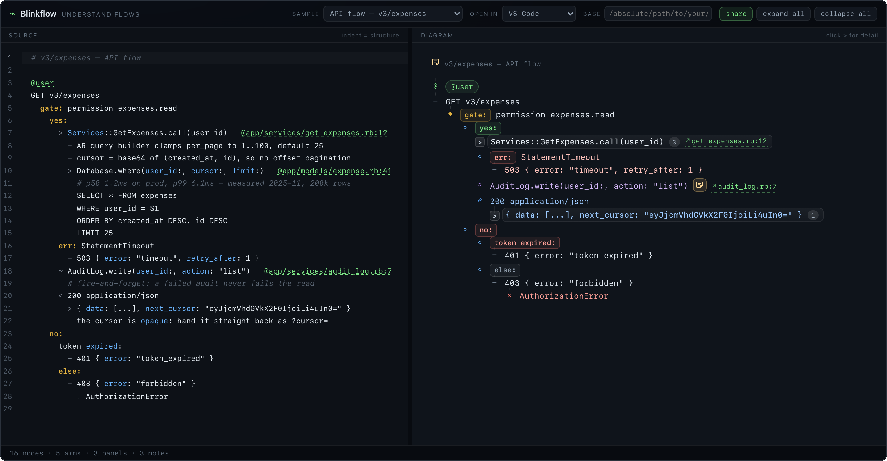
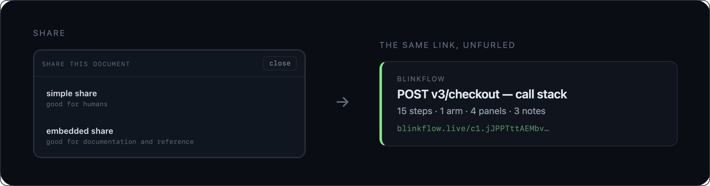
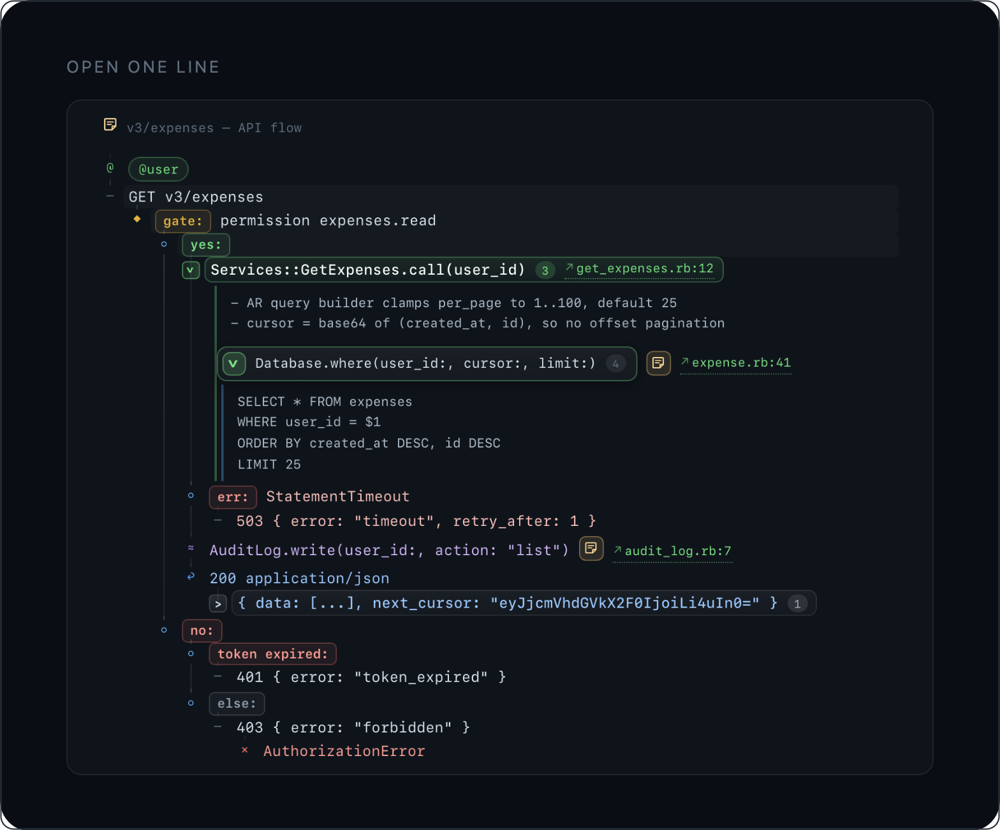

# Blinkflow

**Understand flows with the blink of an eye.** → [blinkflow.live](https://blinkflow.live)

Blinkflow is a tiny text notation for flows, rendered as an interactive diagram. You write plain text; every line that carries detail becomes an accordion, and every line can link back to the code it came from.



## Sound familiar?

You ask an AI how something works, and it starts at the implementation details. You stop it, ask for the high level, and eventually you understand the shape. But not the parts that actually matter: who is allowed to see this data, what happens when it fails, which service is called here. Fifteen questions later your head is full, and you are scrolling back through the thread to piece the answer together.

It happened to me every single time. Whenever I hunted a bug, or asked an AI to explain someone else's code, I ended up overwhelmed, and the one detail I actually needed was buried somewhere in a thread I had already scrolled past twice.

So I stopped asking for better answers and changed the shape instead. Blinkflow puts the whole flow in one place, from the big picture down to the exact line of code, and lets you read it at whatever depth you care about right now.

## What Blinkflow gives you

Four things, one per line:

- **Ask an AI for a flow, get a link, not a wall of text.** The agent reads your code, draws the flow, and answers with a link that unfurls into a diagram.
- **Every line that carries detail is an accordion.** Closed, it still says what is inside; open, the detail is right there in place. Start at the concept, and open only the parts you care about. Nothing is expanded until you ask, and nothing the agent knew is dropped when you don't.
- **The flow stays a map of the code, not a description of it.** Every line can point at the file it came from: `@app/services/payments/charge.rb:9` opens your editor at line 9.
- **No database, no account.** The whole document lives inside the link, compressed. Paste it anywhere; it never expires and never depends on anyone's uptime.

## Ask for a flow

> **You:** how does checkout work, and where can it fail?
>
> **Agent:** One transaction, three writes, and the declined card is a branch you can open. The rest (the auth check, the Stripe timeout, the webhook that settles it) sits one click deeper, on the same page: [blinkflow.live/c1.jJPPTttAEMbv…](https://blinkflow.live/c1.jJPPTttAEMbveYoPcQEpOARoVdwUVUp76AkESD2izXqCR3Z2zcw4Iaoq9SH6Lr33Ufok1dpOOHDh6NlvvvnNHx_i5vruHuvziS_JV7E1_Pv1G97VNdScr0ajVwLgs2uaiY_BJNY1ie7fHl6CmSzy6YcRcAXXWknB2DujgxEAzFsRCpa1SoKlxBWsJCipcgzwMVZMHcjF6RSbkgLcQinYCDjBfCiW5ze185Ql2CPvxMZIfsc7QCVZs6cXuknT6WWRX3YUh4iBYOKCOm8cwxjn2Agb6RjvwWHthF0wHdSB1iT9bKxkRWxNuSA4CD21pAkv9bt2NRfO6CFBvYHm7KxLBDp9iOGEVo1t8fcPUsUt2GgFDlCLvkrhRtgTNLhGy2iYYfoOKw6IddFZHeBrcpg7seH7W9B2uWTPFOwu2XTxE1QZJ5obSboyzL3jK-i-kAPENM-YPXjduuKJjm-bx08jhsplO8dm0G8cT32v1WgMPuGqanCuMVpZtkRUE1L0icUY47E24IzeUltOGKFBZxoWhDQYI6umJwusJ3WpQxVrfkY_Bck2TqSyramnqwjIvjQYyu7OC96fPA2kU1tuIJcQmT1soxQrT-CIS0iUFpbyJkwqQ4f8aGrQQ9NzGk83c1Fs5XcbkcgwtaNdEo-C0q2uITdjSDD4nkmDspvpCvOdCuo7TLYc639NSy7F-ucN9Pa6_sJ5v-460ibygUHB4_dv3s2lMyq0nBu6zZXtgFZjg7neJHT_fARb7nxM_R_wEA)

That link *is* the document: deflate-compressed into the URL, stored nowhere. It unfurls where you paste it, and opening it gives you a flow you can click through, not a message to scroll.





The instructions an agent follows to write a flow, post it, and answer with the link are in [`skills/`](./skills/). Drop them into the agent you already use.

## The language in one minute

A flow is written as plain text. Indentation is the tree, and every operator has exactly one job:

```
GET v3/expenses
  gate: permission expenses.read
    yes:
      - Services::GetExpenses.call(user_id)   @app/services/get_expenses.rb:12
        # the AR query builder clamps per_page and keeps the cursor opaque
        > Database.where(user_id:, cursor:, limit:)
          SELECT * FROM expenses
          WHERE user_id = $1
          LIMIT 25
    no:
      - 403 { error: "forbidden" }
```

| written | means |
| --- | --- |
| `-` / `!` / `~` / `<` | a step / a failure / an async line / a return |
| `>` | an accordion: the line is the element, its detail hides inside it and opens on click (a `>` inside a body nests) |
| `label:` | an arm: a branch, a gate, a value match (`gate:` / `yes:` / `no:` / `else:` / `err:` are reserved) |
| `@path:line` | a source anchor: opens that file in your editor |
| `# note` | a note on the component above: a chip you hover or click; consecutive `#` lines are one note |
| indentation | the tree; `\>` escapes a literal `>` inside a body |

The full rules are in [SPEC.md](./SPEC.md).

## Try it

```bash
make install    # once, on a fresh clone: frontend deps from the lockfile
make dev        # editor + card server on http://localhost:8080
make test       # TypeScript and Go suites
make build      # typecheck, build the site, build the server
```

`make dev` installs the frontend dependencies itself if `frontend/node_modules` is missing, so a fresh clone works with either command order. Node 20+ and Go 1.24+ are all it needs; the server has no dependencies of its own.

### The playground

| pane | |
| --- | --- |
| left | CodeMirror editor with Blinkflow highlighting |
| right | live diagram: click the `>` badge for detail, `↗` to jump to source |

Toolbar: **sample** (three worked examples), **open in** (VS Code, Cursor, Zed, Sublime, `file://`), **base** (the directory anchors are resolved against), **expand all** / **collapse all**, and **share**.

**Tab** indents the current line or every selected line by one level (2 spaces), **Shift-Tab** outdents. Indentation is inserted as spaces, never a literal tab, because the parser rejects tabs: depth is the structure, so the two must agree.

Anchors are relative to *base*, which starts empty. Point it at a repo root and `@app/models/x.rb:41` opens `<base>/app/models/x.rb` at line 41. Until you set it, clicking an anchor asks for the base instead of opening a wrong path.

## Share links

The document travels inside the URL: deflate-compressed, base64url-encoded, and version-prefixed (`c1.…`, or `p1.…` for browsers without `CompressionStream`). There is no database and no account, so a link never expires and never depends on uptime.

**share** opens a dialog with two carriers for the same payload:

| option | link | good for |
| --- | --- | --- |
| **simple share** | `…/#c1.…` | humans: chat, email, a ticket |
| **embedded share** | `…/c1.…` | documentation and reference: an address a page can answer for |

Embedded links are the ones that can unfurl. A preview needs metadata a crawler can read without running JavaScript, so `backend/` decodes the payload, counts the document, and answers with the app shell whose `<head>` describes *that* document. The browser then decodes the same payload again and draws it.

```
curl -A "Slackbot" http://localhost:8080/c1.…
  <title>POST v3/checkout — call stack — Blinkflow</title>
  <meta property="og:title" content="POST v3/checkout — call stack" />
  <meta property="og:description" content="15 steps · 1 arm · 4 panels · 3 notes" />
```

What the server is not: it stores nothing, logs no document (requests are logged as `c1.<redacted> (769 chars)`), has exactly one endpoint that accepts a body (`POST /share`, which also stores nothing), and is never on the path of *reading* a link. Kill it and every link still opens; only the card falls back to a generic title.

## Share API

An agent that has worked out a flow should be able to hand back a link instead of fifteen paragraphs. `POST /share` takes the document as the body and answers with the links, plus a summary of what it understood. Newlines are the structure, so the bytes are taken exactly as sent.

```bash
curl -sS -X POST https://blinkflow.live/share \
  -H 'content-type: text/plain' \
  --data-binary @flow.lg
```

```json
{
  "links": {
    "embedded": "https://blinkflow.live/c1.…",
    "simple": "https://blinkflow.live/#c1.…"
  },
  "payload": "c1.…",
  "title": "v3/expenses — API flow",
  "description": "10 steps · 2 arms · 4 panels · 2 notes · gate: permission expenses.read",
  "steps": 10,
  "arms": 2,
  "panels": 4,
  "notes": 2,
  "source_bytes": 1242,
  "payload_chars": 934
}
```

Both carriers are returned by default; `?mode=embedded` (or `"mode": "…"` in a JSON body) asks for one. `"mode"` is the share dialog's own word for the same choice, and the route is named for what a caller wants rather than how a payload is packed: a new carrier, such as an image preview, arrives as another key under `links` rather than another endpoint.

`application/json` with `{"source": "…"}` works too. The summary is not decoration: the payload is opaque to the caller, so the counts are the only way to notice that a document arrived as one flat step.

It is a pure function, so the same document always produces the same link. It is capped, `no-store`, and logged by size only. The links it builds are the format the editor builds: `share.Encode` is a second implementation of the same format, and a test decodes the server's payload with the app's own decoder, so the two cannot disagree without CI failing. Only the version prefix is shared between them, so a format change is a new prefix (`c2.…`) that old clients refuse loudly instead of rendering wrong.

## Skills

`skills/` holds instructions written for AI agents, served from that folder at `/skills/`. The folder is the endpoint, no build step. The first one teaches an agent to explain how a piece of code works:

```
https://blinkflow.live/skills/explain-code-flow/SKILL.md
```

It tells an agent to read the code, draw the flow, post it to `/share`, and answer with the link, never with the document or the code. Reference files and three worked examples at three levels of abstraction sit beside it, and a test parses every example so a broken one fails CI instead of reaching an agent.

## Self-hosting

### Running it

`make dev` is the whole development setup. Deployed, the same binary serves the built site:

| flag | default | |
| --- | --- | --- |
| `-addr` | `127.0.0.1` | loopback; set deliberately when it faces a network |
| `-port` | `8080` | |
| `-static` | `../frontend/dist` | the built site, served with an SPA fallback |
| `-public-origin` | — | `https://blinkflow.example.com`; the origin every generated URL claims |
| `-trust-proxy` | off | believe `X-Forwarded-Proto`/`-Host`, only behind a proxy you control |
| `-max-payload` | `64 KiB` | largest decoded document |

Set `-public-origin` in any deployment: it makes canonical URLs and embedded links independent of whatever headers a request arrives with. Without it the server uses the request's own `Host`, and ignores forwarded headers unless `-trust-proxy` says otherwise: a client must not be able to choose the origin a page claims.

### Container

`make image` builds the same three-stage image CI publishes. Node compiles the site, Go cross-compiles the server, and the runtime layer carries only the binary and the built assets in a distroless image: no shell, no toolchain, no sources. The server serves those assets itself, so a container is one process on one port.

```bash
make image-run                       # build, then serve on :8080
docker run -p 8080:8080 -e BLINKFLOW_PUBLIC_ORIGIN=https://blinkflow.live ghcr.io/a-chris/blinkflow:latest
```

Two tags are published, with one rule: a push to the default branch publishes `latest`, and a pushed tag publishes that tag verbatim. Releasing a version therefore never moves `latest` under someone who pulled yesterday.

```bash
git tag v0.2.0
git push origin v0.2.0               # ghcr.io/a-chris/blinkflow:v0.2.0
```

Every deployment flag also reads an environment variable, because a compose file or an image cannot pass arguments; a flag still wins when it is given. The image sets the two a container needs: `BLINKFLOW_ADDR=0.0.0.0` and `BLINKFLOW_STATIC=/app/dist`.

| variable | overrides |
| --- | --- |
| `BLINKFLOW_ADDR` | `-addr` |
| `BLINKFLOW_PORT` | `-port` |
| `BLINKFLOW_STATIC` | `-static` |
| `BLINKFLOW_PUBLIC_ORIGIN` | `-public-origin` |
| `BLINKFLOW_TRUST_PROXY` | `-trust-proxy` |
| `BLINKFLOW_MAX_PAYLOAD` | `-max-payload` |

There is no shell and no `curl` in the image, so `/healthz` is what an orchestrator polls.

### Local configuration

A tunnel hostname or a public origin is nobody else's business, so it lives in `frontend/.env.local` (gitignored; see `.env.example`):

| variable | |
| --- | --- |
| `BLINKFLOW_ALLOWED_HOSTS` | extra dev-server hostnames, comma separated |
| `BLINKFLOW_SERVER_ORIGIN` | where embedded links should point |
| `BLINKFLOW_SERVER_PORT` | the card server's port, when it is not 8080 |

## Structure

```
frontend/              the app: everything that runs in a browser
  src/lang/parser.ts   text → tree (+ issues)
  src/lang/render.ts   tree → DOM (accordions, anchors)
  src/lang/share.ts    payload encode/decode, both link carriers
  src/lang/anchors.ts  path resolution, editor deep links
  src/lang/editor.ts   CodeMirror theme + tokenizer
  src/samples/         three examples
  src/main.ts          playground wiring
backend/               the card server (Go, standard library only)
  internal/share/      payload decode, size-capped, version-checked
  internal/flow/       counts and first note/gate, mirroring the parser
  internal/og/         the card rules
  internal/web/        routing: payload pages, dev proxy, static files
skills/                agent skills, served at /skills/
docs/                  the README's screenshots: playground, card, accordion
testdata/og/           fixtures both languages assert against
.github/workflows/     the two test suites, the image build and its publish to GHCR
Makefile               dev, test, build, image
VISION.md              what the notation is for, and what an operator may mean
AGENTS.md              how to work in here, for an agent (or a person in a hurry)
```

No framework: the renderer builds DOM directly, which keeps the language portable if you later want a CLI, a markdown plugin, or a static-site renderer.

**`make dev`** runs Vite on 5174 and the card server on 8080, and the server proxies everything that is not a payload to Vite. So there is one origin to open, and hot reload still works through the proxy.

The counting rules exist twice: once in the TypeScript parser, once in Go. `testdata/og` is the contract: the same `.lg` fixtures and the same expected `.json` values are asserted by `frontend/src/lang/preview.test.ts` and `backend/internal/flow`, so the two cannot drift without a test failing. The expected values were generated from the parser (the reference) and then fixed.

## Licence

[Elastic License 2.0](./LICENSE). Use it, self-host it, modify it, build on it. Hosting it for third parties as a managed service is the one thing reserved for the project. The Blinkflow name and marks are not covered by the licence, and this is not an OSI open-source licence.
